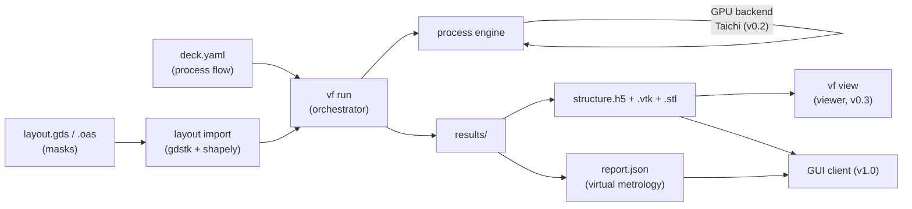

# voxelfab — Product Architecture v1

**What we're building:** a virtual-fabrication engine (SEMulator3D class) as a
kernel-first product. Inputs are files — a **process deck** (YAML) and a
**layout** (GDS/OAS). Outputs are files — a 3D **structure** (HDF5/VTK/STL) and
**virtual metrology** reports (JSON). The kernel is backend-agnostic (CPU
NumPy/Numba now, Taichi GPU next), every step is deterministic, and a GUI —
later — is just a client on top of the same file and CLI interfaces.

---

## 1. Product principles

1. **Kernel-first, GUI-last.** Everything usable from the command line and
   from files before any UI exists. This is what makes the tool scriptable,
   automatable, and testable — and it forces the GUI to be a thin client,
   never a dependency of the engine.
2. **Determinism is a contract.** Same deck + same layout + same version →
   byte-identical structure (we hash it). Required for regression tests,
   customer support, and trust in reported metrology.
3. **File formats are the API.** The deck DSL, the layout import, HDF5
   structures, and JSON reports are public, versioned interfaces. A GUI, a
   web service, or a customer's script are all equal clients.
4. **Backend-agnostic step semantics.** Each process step is a pure function
   `(grid, params) → grid` with a written reference semantics. The CPU
   implementation is the reference; the GPU implementation must match it
   exactly (voxel-exact, not fuzzy-equal).
5. **Units and names, never raw indices, in user-facing inputs.** Decks
   speak nm and material names; voxels are an internal resolution detail.

---

## 2. System overview



One command does everything: `vf run mydeck.yaml --layout inv.gds -o out/`.

---

## 3. Repository layout

```
voxelfab/
├── pyproject.toml            # package + extras: [gpu] [layout] [view] [bench]
├── README.md
├── src/voxelfab/
│   ├── __init__.py
│   ├── grid.py               # VoxelGrid, materials registry, height map
│   ├── ops/
│   │   ├── base.py           # step registry + REFERENCE SEMANTICS (docstrings)
│   │   ├── cpu.py            # scipy/numba implementation (the reference)
│   │   └── gpu.py            # Taichi implementation (v0.2, extra [gpu])
│   ├── deck.py               # YAML schema, validation, deck→step pipeline
│   ├── layout.py             # GDS/OAS import → masks (gdstk + shapely)
│   ├── run.py                # orchestrator: flow execution, outputs, provenance
│   ├── metro.py              # virtual metrology (measurements as deck outputs)
│   ├── export.py             # HDF5, VTK, STL, PNG renderers
│   └── cli.py                # vf run | info | demo | report | view | sweep
├── decks/                    # shipped example decks (MOSFET, CMOS, FinFET)
├── tests/
│   ├── test_reference/       # golden structures on 32³ grids (byte-exact)
│   ├── test_equiv/            # CPU vs GPU equivalence (must be exact)
│   └── bench/                 # scaling benchmarks (nightly CI)
└── docs/                     # deck DSL reference, step semantics, formats
```

---

## 4. The process deck DSL (v1)

The deck is the product's centerpiece — the "process input" users iterate on.

```yaml
version: 1
grid:
  pitch_nm: 2.0        # nm per voxel (z resolution derived from steps)
  nx: 120
  ny: 60
  nz: 64

materials:
  Si:   { color: "#4d79ff" }
  SiO2: { color: "#c9c9c9" }
  poly: { color: "#e64a19" }
  W:    { color: "#5d4037" }

layout:                # optional — masks come from GDS/OAS instead of geometry
  file: inv.gds
  cell: TOP
  bias_nm: -2.0        # mask bias (lateral etch compensation)
  layers:              # deck-level name → (layer, datatype)
    sti:        [1, 0]
    gate:       [10, 0]
    contact_s:  [20, 0]
    contact_d:  [21, 0]

steps:
  - { op: substrate, material: Si, thickness_nm: 40 }
  - { op: etch,     depth_nm: 12, mask: { layer: sti } }           # STI dig
  - { op: fill,    material: SiO2, to_plane_z: 19 }
  - { op: cmp,     target_z: 19, stop_on: Si }
  - { op: deposit, material: SiO2, thickness_nm: 4 }                # gate ox
  - { op: deposit, material: poly, thickness_nm: 36 }
  - { op: etch,     depth_nm: 60, mask: { invert: { layer: gate } },
      materials: [poly] }                                          # gate RIE
  - { op: etch,     depth_nm: 4, mode: isotropic, materials: [SiO2],
      mask: { invert: { layer: gate } } }
  - { op: deposit, material: Si, thickness_nm: 12,
      mode: directional, on_materials: [Si] }                     # epi S/D
  - { op: deposit, material: SiO2, thickness_nm: 50 }
  - { op: cmp,     target_z: 52 }
  - { op: etch,     depth_nm: 60, until: Si, mask: { layer: contact_s } }
  - { op: deposit, material: W, thickness_nm: 60, mode: directional }
  - { op: cmp,     target_z: 52 }

outputs:
  - { type: views,  file: mos3d.png }
  - { type: vtk,    file: mos3d.vtk }
  - { type: report, file: report.json }
```

### DSL rules

| Rule | Detail |
| ---- | ------ |
| Units | Every length is `*_nm`; voxels are derived, never written |
| Materials | Referenced by name; registered once in `materials` |
| Masks | `{layer: <name>}` from layout, or geometry (`rect`, `bands`), composable with `invert` |
| Steps | Ordered list; each `op` has a fixed schema, validated with explicit errors before execution |
| `version` | Deck-format version; loaders migrate old decks explicitly |
| Determinism | Deck hash + layout hash + engine version stored in every output |

### Step semantics (reference, v1)

| Op | Mode(s) | Semantics |
| -- | ------- | --------- |
| `substrate` | — | Fill bottom of grid with material |
| `deposit` | `conformal`, `directional` | Constant-thickness shell (dilation) / vertical fill above exposed surfaces; `on_materials:` = selective |
| `etch` | `isotropic`, `directional` | Uniform removal (erosion) / vertical RIE with `materials`, `until`, `mask` |
| `fill` | — | Fill open trenches under a plane |
| `cmp` | — | Planarize to plane, optional `stop_on` barrier |

These docstrings live in `ops/base.py` and are **the contract**: the GPU
backend must reproduce them voxel-for-voxel.

---

## 5. Kernel architecture and the GPU path

### Layered kernel design

- `grid.py` — data (uint8 label grid, materials, height map) with a stable,
  backend-neutral in-memory format.
- `ops/base.py` — registry: `(op, mode) → implementation`, per backend.
- `ops/cpu.py` — today's vectorized SciPy/Numba kernel (already written).
- `ops/gpu.py` — Taichi port. Same signatures, `ti.field`-backed.

### Taichi design notes

- **Memory:** 100 M voxels = 100 MB uint8 — fits any modern GPU; the height
  map (int32) and a couple of bool work buffers ≈ 3–4× grid size. Up to
  ~1 G voxels a single GPU still works; beyond that, **tiled execution with
  halos** (each step is local with known radius, so halo size is exact).
- **Kernels needed (all embarrassingly parallel):** ball dilate/erode (loop
  over structuring element offsets), directional deposit/etch (one thread per
  column, sequential z-walk inside the thread — Taichi handles this well),
  CMP (single pass over z with per-column stop index), height map
  (`ti.atomic_max` — order-independent, therefore deterministic).
- **Determinism rules:** only order-independent reductions (min/max); no
  float atomics; integer-only comparisons. GPU and CPU results must hash
  identically — this is the release gate.
- **Backend selection:** `vf run --backend auto` → GPU if `taichi` present,
  else CPU. Both backends always shipped; GPU is an optional extra.

### Sketch (conformal deposit, GPU)

```python
import taichi as ti

@ti.kernel
def dilate_ball(data: ti.types.ndarray(dtype=ti.u8, ndim=3),
                out:  ti.types.ndarray(dtype=ti.u8, ndim=3),
                nx: ti.i32, ny: ti.i32, nz: ti.i32, r: ti.i32):
    for x, y, z in out:                    # parallel over all voxels
        hit = 0
        for dx, dy, dz in ti.static(ti.ndrange(2*r+1, 2*r+1, 2*r+1)):
            if (dx-r)**2 + (dy-r)**2 + (dz-r)**2 <= (r+0.5)**2:
                xs, ys, zs = x+dx-r, y+dy-r, z+dz-r
                if 0 <= xs < nx and 0 <= ys < ny and 0 <= zs < nz:
                    if data[xs, ys, zs] != 0:
                        hit = 1
        out[x, y, z] = hit
```

---

## 6. Data formats

| Artifact | Format | Notes |
| -------- | ------ | ----- |
| Structure | **HDF5** | uint8 grid (chunked + gzip), materials table, provenance attrs (deck hash, layout hash, engine version, backend, timestamps) |
| 3D views | VTK (ParaView) / STL per material | via pyvista / skimage, extras |
| Metrology | JSON | named measurements + the provenance block |
| Decks | YAML | the user-facing interface |
| Layouts | GDSII / OASIS | via gdstk |

Provenance block (same in every output file) makes any result reproducible and
auditable — non-negotiable for an external-facing product.

---

## 7. Packaging & distribution

- `pip install voxelfab` — pure-Python wheel; extras:
  `[gpu]` taichi, `[layout]` gdstk + shapely, `[view]` pyvista + matplotlib,
  `[bench]` numba.
- Python ≥ 3.10. No hard dependency on any GPU stack.
- Licenses are all permissive (gdstk: Boost; shapely: BSD-3; Taichi: MIT;
  PyYAML: MIT) — safe for a commercial product.
- Semantic versioning; deck `version` field decouples user decks from engine
  releases.

## 8. Quality gates

1. **Reference tests:** tiny grids (32³), committed expected structures —
   byte-exact. Any semantic change bumps deck version + regenerates goldens
   with a reviewed diff.
2. **Equivalence tests:** CPU vs GPU on medium grids — exact match required.
3. **Nightly benchmarks:** step timings at 10⁷ / 10⁸ voxels tracked over time
   (performance regressions are product regressions).

## 9. Roadmap

| Milestone | Scope | Exit criteria |
| --------- | ----- | ------------- |
| **v0.1** | Package split, deck DSL + validation, HDF5 outputs, CLI, golden tests | `vf run decks/mosfet.yaml` works for external users |
| **v0.2** | Taichi GPU backend + equivalence tests | GPU ≈ 10–50× CPU at 10⁸ voxels, identical hashes |
| **v0.3** | `vf view` (PyVista) + metrology DSL (measurements as outputs) | Demo walkthrough without reading Python |
| **v0.4** | `vf sweep` (DOE over deck parameters) | One command, N runs, metrology table out |
| **v1.0** | GUI client (web or Qt) on the same file/CLI interfaces | Kernel untouched |

The seed for v0.1 is the `vfdeck.py` runner (second canvas): a single-file
deck interpreter over the existing kernel, which becomes `deck.py` + `run.py`
+ `cli.py` when the package is split.